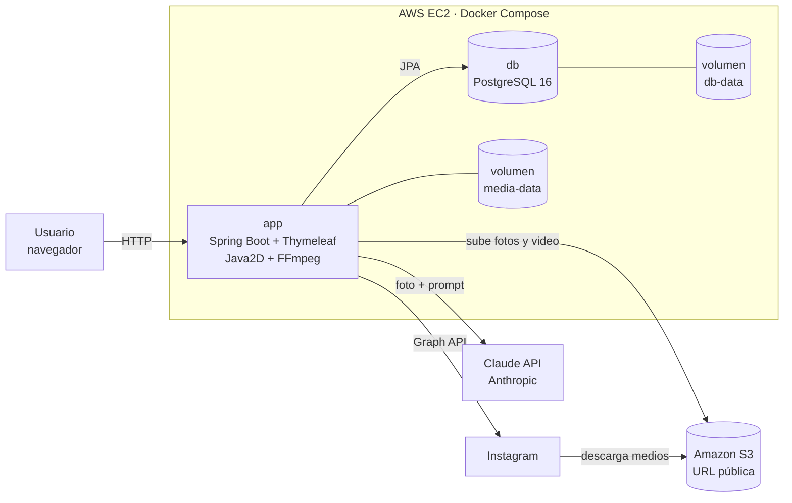
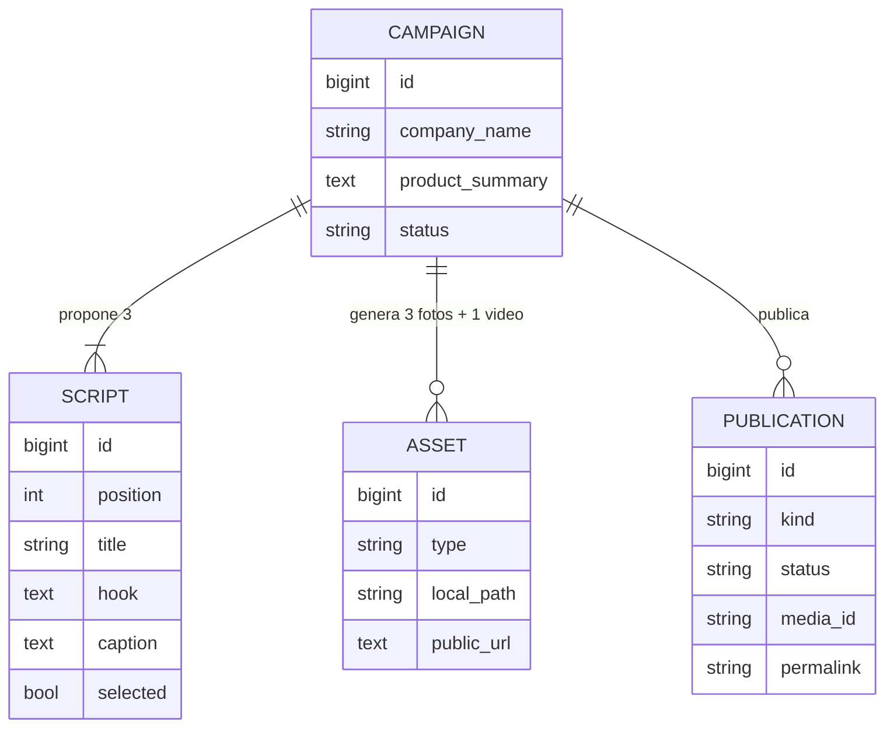

# Marketing AI: campañas para Instagram a partir de una foto

Aplicación web en **Java 21 + Spring Boot** que automatiza una campaña de marketing para empresas:

1. **El sistema recibe una foto** del producto o servicio.
2. **El sistema propone 3 guiones**: Claude (Anthropic) analiza la foto y escribe 3 enfoques creativos distintos (gancho, narración, titulares, CTA, texto del post, hashtags y color de marca).
3. **Se escoge uno** de los guiones.
4. **El sistema genera 3 fotos publicitarias y un video** (reel vertical 9:16 hecho con FFmpeg) y **los publica en Instagram** (carrusel con las 3 fotos + reel).

Laboratorio 05 de Diseño de Software, Pregunta 2.

---

## Arquitectura



| Capa | Paquete | Responsabilidad |
|------|---------|-----------------|
| Presentación | `web`, `templates/` | Controlador MVC y vistas Thymeleaf |
| Lógica de negocio | `service` | `CampaignService` orquesta los 4 pasos |
| Integraciones | `ai`, `media`, `social` | Claude, composición de imágenes, FFmpeg, S3, Instagram |
| Acceso a datos | `domain`, `repository` | Entidades JPA y repositorio Spring Data |

### Modelo de datos



### Cómo se genera cada pieza

| Pieza | Tecnología |
|-------|------------|
| Análisis de la foto y 3 guiones | Claude API (`claude-opus-5-5`) con salida estructurada en JSON, mediante el SDK oficial `anthropic-java` |
| 3 fotos 1080×1350 | Java2D: 3 diseños distintos (foto completa con degradado, foto + panel de color, foto enmarcada) con los titulares, el CTA y el color del guion elegido |
| Video 1080×1920 (~10 s) | FFmpeg: 3 cuadros verticales con transiciones `xfade`, H.264 + AAC |
| Publicación | Instagram Graph API (Content Publishing): carrusel + reel |

---

## Tecnologías

Java 21 · Spring Boot 3.5 (Web, Thymeleaf, Data JPA, Actuator) · PostgreSQL 16 · Anthropic Java SDK · AWS SDK v2 (S3) · FFmpeg · Docker / Docker Compose · AWS (EC2 + S3)

## Estructura

```
├── Dockerfile               # build multi-stage (Maven → JRE + FFmpeg)
├── docker-compose.yml       # app + PostgreSQL con volúmenes
├── .env.example             # plantilla de variables de entorno
├── pom.xml
└── src/main
    ├── java/com/lab5/marketing
    │   ├── ai/              # ScriptGenerator (Claude) y ScriptProposal
    │   ├── config/          # AppProperties, WebConfig
    │   ├── domain/          # Campaign, Script, Asset, Publication
    │   ├── media/           # CreativeRenderer, VideoRenderer, StorageService, ImageUtils
    │   ├── repository/      # CampaignRepository
    │   ├── service/         # CampaignService
    │   ├── social/          # InstagramPublisher
    │   └── web/             # CampaignController
    └── resources
        ├── application.yml
        ├── static/css/
        └── templates/       # index.html, campaign.html, fragments.html
```

---

## Variables de entorno

Se configuran en el archivo `.env` (copia de `.env.example`). Ningún secreto se sube al repositorio.

| Variable | Obligatoria | Descripción |
|----------|:-----------:|-------------|
| `APP_PORT` | No | Puerto del host (por defecto `8080`; en AWS `80`) |
| `DB_NAME`, `DB_USER`, `DB_PASSWORD` | Sí | Credenciales de PostgreSQL |
| `PUBLIC_BASE_URL` | Sí | URL pública de la app, p. ej. `http://<IP-EC2>` |
| `ANTHROPIC_API_KEY` | No* | API key de Claude. *Sin ella la app usa guiones de ejemplo (modo demo)* |
| `CLAUDE_MODEL` | No | Modelo de Claude (por defecto `claude-opus-5-5`) |
| `S3_BUCKET`, `AWS_REGION` | No* | Bucket público para las fotos y el video. *Necesario para publicar en Instagram* |
| `INSTAGRAM_ACCESS_TOKEN`, `INSTAGRAM_USER_ID` | No* | Credenciales de Instagram. *Sin ellas la publicación queda simulada* |
| `INSTAGRAM_GRAPH_URL` | No | Por defecto `https://graph.instagram.com/v23.0` |

> La app arranca y se puede probar de punta a punta **sin ninguna API key**: genera guiones de ejemplo, fotos, video y registra una publicación simulada.

---

## Instalación y ejecución local

### Requisitos

- [Docker Desktop](https://www.docker.com/products/docker-desktop/) (incluye Docker Compose)
- Git

### Pasos

```bash
git clone https://github.com/fabio2152/LAB5_2.git
cd LAB5_2
cp .env.example .env        # completa las claves que tengas
docker compose up -d --build
```

Abre <http://localhost:8080> (o el puerto que pusiste en `APP_PORT`).

Comandos útiles:

```bash
docker compose ps                 # estado de los contenedores
docker compose logs -f app        # logs de la aplicación
docker compose down               # detener (los datos quedan en los volúmenes)
docker compose down -v            # detener y borrar los datos
```

### Ejecutar sin Docker (desarrollo)

Necesitas JDK 21, Maven, FFmpeg en el `PATH` y un PostgreSQL local:

```bash
mvn spring-boot:run
```

### Tests

```bash
docker run --rm -v "$PWD":/build -w /build maven:3.9-eclipse-temurin-21 mvn -B test
```

---

## Uso

1. En la página principal sube una foto (JPG o PNG), escribe el nombre de la empresa y, opcionalmente, qué vende y a quién.
2. Pulsa **Generar 3 guiones**: Claude analiza la foto y propone 3 guiones.
3. Pulsa **Elegir este guion** en el que prefieras: se generan las 3 fotos y el reel.
4. Pulsa **Publicar ahora**: se publica el carrusel y el reel en Instagram y aparecen los enlaces a las publicaciones.

---

## Obtener las credenciales

### Claude (Anthropic)

1. Entra a <https://platform.claude.com>, crea una cuenta y agrega crédito en *Billing*.
2. En *API Keys* crea una clave y pégala en `ANTHROPIC_API_KEY`.

### Instagram (Graph API con inicio de sesión de Instagram)

1. Convierte tu cuenta de Instagram en **profesional** (Creador o Empresa) desde la app de Instagram.
2. En <https://developers.facebook.com> crea una app de tipo **Empresa** y agrega el producto **Instagram → API setup with Instagram login**.
3. En *Roles de la app → Evaluadores de Instagram* agrega tu cuenta y acepta la invitación desde Instagram (*Configuración → Apps y sitios web*).
4. En *Generate access tokens* agrega tu cuenta, genera el token (permisos `instagram_business_basic` e `instagram_business_content_publish`) y cópialo en `INSTAGRAM_ACCESS_TOKEN`.
5. Copia el ID de la cuenta de Instagram que aparece junto al token en `INSTAGRAM_USER_ID`.

Instagram descarga las fotos y el video desde una URL pública, por eso se usa S3.

---

## Despliegue en AWS (EC2 + S3)

### 1. Bucket S3 para los medios

1. S3 → *Create bucket*, nombre único (p. ej. `marketing-ai-medios-<tu-nombre>`), región `us-east-1`.
2. Desmarca **Block all public access** (confirma la advertencia).
3. En *Permissions → Bucket policy* pega (cambia el nombre del bucket):

```json
{
  "Version": "2012-10-17",
  "Statement": [{
    "Sid": "PublicReadCampaigns",
    "Effect": "Allow",
    "Principal": "*",
    "Action": "s3:GetObject",
    "Resource": "arn:aws:s3:::marketing-ai-medios-<tu-nombre>/campaigns/*"
  }]
}
```

### 2. Rol IAM para la instancia

IAM → *Roles → Create role* → *AWS service: EC2* → crea el rol `marketing-ai-ec2` con esta política en línea:

```json
{
  "Version": "2012-10-17",
  "Statement": [{
    "Effect": "Allow",
    "Action": ["s3:PutObject"],
    "Resource": "arn:aws:s3:::marketing-ai-medios-<tu-nombre>/campaigns/*"
  }]
}
```

### 3. Instancia EC2

- AMI: **Amazon Linux 2023**, tipo **t3.small** (2 GB de RAM, para compilar con Maven).
- Key pair: crea uno y descarga el `.pem`.
- Security group: entrada **SSH (22)** desde tu IP y **HTTP (80)** desde `0.0.0.0/0`.
- Almacenamiento: 20 GB gp3.
- *Advanced details → IAM instance profile*: `marketing-ai-ec2`.

### 4. Instalar Docker y desplegar

```bash
ssh -i marketing-ai.pem ec2-user@<IP-PUBLICA>

sudo dnf install -y docker git
sudo systemctl enable --now docker
sudo usermod -aG docker ec2-user
sudo mkdir -p /usr/local/lib/docker/cli-plugins
sudo curl -SL https://github.com/docker/compose/releases/download/v2.39.2/docker-compose-linux-x86_64 \
     -o /usr/local/lib/docker/cli-plugins/docker-compose
sudo chmod +x /usr/local/lib/docker/cli-plugins/docker-compose
exit   # vuelve a entrar para que aplique el grupo docker
```

```bash
ssh -i marketing-ai.pem ec2-user@<IP-PUBLICA>
git clone https://github.com/fabio2152/LAB5_2.git
cd LAB5_2
cp .env.example .env
nano .env   # APP_PORT=80, PUBLIC_BASE_URL=http://<IP-PUBLICA>, S3_BUCKET, claves...
docker compose up -d --build
```

La app queda en `http://<IP-PUBLICA>`.

Para actualizar después de un cambio en el repositorio:

```bash
cd LAB5_2 && git pull && docker compose up -d --build
```

---

## Evidencias

Las capturas de pantalla del funcionamiento se incluyen en el informe del laboratorio.
